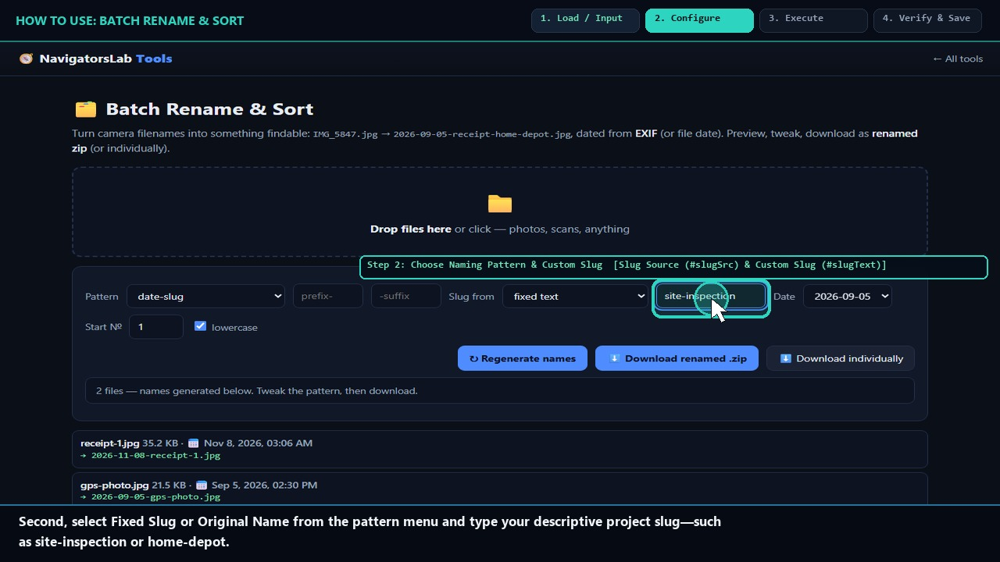
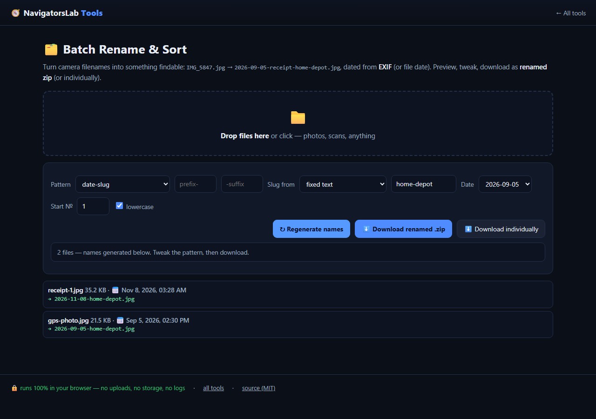

# 🗂 Batch Rename & Sort

> IMG_5847.jpg → 2026-09-05-receipt-home-depot.jpg

     

<h4 align="center">
  &#9654; <a href="https://navigatorslab.com/tools/rename.html">Open it on navigatorslab.com</a> &mdash; free, no sign-up, nothing uploaded<br>
  <a href="https://navigatorslab.com/Batch-Rename">navigatorslab.com/Batch-Rename</a> &middot; <a href="https://navigatorslab.com/tools/videos/rename.mp4">🔊 Watch Narrated Step-by-Step Tutorial Video</a> &middot; <a href="https://navigatorslab.com/tools/videos/notebooklm-overview.mp4">Watch Full Suite Hands-On Video</a><br>
  This repo's Pages site runs the <em>actual tool</em>: <code>demo.html</code>
</h4>



EXIF-dated batch renaming with prefix, suffix and sequence start — previewed live, downloaded as a zip.

## 📖 Complete Step-by-Step User Guide

### Step 1: Drop a Batch of Photos or Files to Rename (`Batch Dropzone (#dz)`)
- **How to do it:** Drag and drop a batch of photos or documents (`IMG_4821.JPG`, `DSC0092.JPG`, etc.) onto `#dz`.
- **Expected result:** Files load and EXIF `DateTimeOriginal` timestamps (or file modified dates) are extracted.

### Step 2: Choose Naming Pattern & Custom Slug (`Slug Source (#slugSrc) & Custom Slug (#slugText)`)
- **How to do it:** Select the naming rule in `#slugSrc` (e.g., `fixed` custom slug or cleaned original filename), type your label into `#slugText` (e.g., `site-inspection`), and configure sequence padding.
- **Expected result:** Pattern rule (`YYYY-MM-DD-<slug>-01.ext`) is configured.

### Step 3: Click Preview New Names to Inspect Mapping (`Apply Preview (#apply) & Mapping List (#list)`)
- **How to do it:** Click **Apply (`#apply`)** and inspect the `Old Name → New Name` preview table in `#list`.
- **Expected result:** Deterministic, collision-free filenames previewed side-by-side.

### Step 4: Download All Renamed Files as One ZIP (`Download ZIP Button (#zip)`)
- **How to do it:** Click **Download ZIP (`#zip`)** to package all renamed files into a single local `.zip` archive via `JSZip`.
- **Expected result:** Cleanly named archive downloaded while original files remain untouched.

## 🎛️ UI Controls, Shortcuts & Parameters Reference

| Control / Shortcut | What It Does |
|---|---|
| `Batch Dropzone (`#dz`)` | Accepts any number of images or documents for batch renaming. |
| `Slug Mode (`#slugSrc`) & Text (`#slugText`)` | Combines EXIF/file dates (`YYYY-MM-DD`) with a custom project slug and sequence numbers. |
| `Apply Preview (`#apply`)` | Updates the live `Old → New` filename table (`#list`). |
| `Download ZIP (`#zip`)` | Bundles all renamed files into one `.zip` archive. |

## 💡 Pro Tips & Real-World Workflows

- 💡 Combining photos from two different cameras (e.g., an iPhone and a Sony mirrorless)? Batch Rename sorts and names them by EXIF capture date so both cameras' shots interleave in true chronological order.
- 💡 Use lowercase hyphenated slugs (`2026-11-08-client-workshop-01.jpg`) for web assets and S3/Cloudflare R2 uploads so URLs never contain `%20` spaces.
- 💡 Your original files on disk are never overwritten—the renamed copies are delivered cleanly inside the downloaded `.zip`.

## 🧪 Concrete Example: Input → Engine → Output

| Stage | What Happens | Details |
|---|---|---|
| **1. Raw Input** | **Camera Roll Dump: IMG_5847.jpg, DSC_0019.jpg...** | Opaque filenames from 3 phones; EXIF capture timestamps buried inside each file |
| **2. On-Device Engine** | **Reads EXIF capture date per file, applies '{date}-{prefix}-{seq}' template with live table preview, packs via JSZip** | Runs 100% client-side in your browser tab under strict `CSP` (`connect-src 'none'`). |
| **3. Verified Output** | **renamed-photos.zip** | 2026-09-05-receipt-001.jpg, 2026-09-06-receipt-002.jpg ... cleanly sorted and zipped in-browser |

```text
IMG_5847.jpg -> 2026-09-05-receipt-001.jpg | IMG_5848.jpg -> 2026-09-06-receipt-002.jpg [OK]
```

- 🔊 **Narrated Step-by-Step Usage Tutorial Video (`33s`):** [`demo.mp4`](./demo.mp4) (also live at [`https://navigatorslab.com/tools/videos/rename.mp4`](https://navigatorslab.com/tools/videos/rename.mp4))
- 🎬 **Full Suite Hands-On Video Guide:** [`https://navigatorslab.com/tools/videos/notebooklm-overview.mp4`](https://navigatorslab.com/tools/videos/notebooklm-overview.mp4)

## ✅ What it does

- EXIF-dated batch renaming: IMG_5847.jpg → 2026-09-05-receipt-home-depot.jpg
- Prefix, suffix and sequence start — previewed live before anything happens
- Download the organized files as a ZIP

## 🚀 Try it in 30 seconds

1. Drop the files
2. Set the EXIF-date pattern, prefix, suffix, sequence
3. Preview, then download the ZIP

## 📸 Live UI in action



## 🔒 Private by design

- **100% on-device** — files are processed in your browser and **never uploaded** to any server
- **No accounts, no tracking, no cookies, nothing retained** — open the page and work
- **Works offline** once loaded; fully mobile-friendly
- **Free & open source (MIT)** — use it at home, at work, anywhere

## 🤖 Built for humans *and* AI agents

- Deep-linkable via URL parameters — see the [Agent Mode guide](https://navigatorslab.com/tools/agents.html)
- Machine-readable catalog: [llms.txt](https://navigatorslab.com/tools/llms.txt) · [llms-full.txt](https://navigatorslab.com/tools/llms-full.txt)
- MCP endpoint: `POST https://navigatorslab.com/tools/mcp` (tool catalog + deterministic text tools — see the [main repo](https://github.com/Kayforkind/NavigatorsLab-Tools))
- No build step required to *use* any tool — just the URL

## 🛠 Under the hood

EXIF capture dates + client-side ZIP, nothing touches a server

Third-party components are catalogued in [NOTICE](NOTICE); this repo is MIT-licensed ([LICENSE](LICENSE)).

## 🗂 The NavigatorsLab Tools suite

The full catalog — every tool in the hub with the same zero-upload promise, plus the lab's apps, CLIs and engines:

| Tool | What it does | |
|---|---|---|
| 🛡 Photo Privacy Kit | Strip GPS, camera model and timestamps before posting | [Open](https://navigatorslab.com/tools/exif.html) |
| 🔐 Password Breach Checker | Has this password been breached? — it never leaves your tab | [Open](https://navigatorslab.com/tools/breachcheck.html) |
| 🔍 Metadata & Hidden-Data Checker | See what's really inside a file — then strip it | [Open](https://navigatorslab.com/tools/metadata.html) |
| 🗜 Image Shrinker | Hit “max 2 MB” portal limits without TinyPNG | [Open](https://navigatorslab.com/tools/shrink.html) |
| 📄 Scan & Screenshot Cleaner | Phone photos of documents → clean, straight PDFs | [Open](https://navigatorslab.com/tools/scan.html) |
| ✍ Local E-Sign Pad | Sign this lease tonight — not DocuSign | [Open](https://navigatorslab.com/tools/sign.html) |
| 🧾 Receipts → One PDF | Shoebox of receipt photos → one date-sorted PDF | [Open](https://navigatorslab.com/tools/receipts.html) |
| 🔢 Receipt OCR → CSV | Read totals off receipt photos, export for expenses | [Open](https://navigatorslab.com/tools/ocr.html) |
| 🔳 QR Studio | Generate QR codes and decode QR images — no site sees them | [Open](https://navigatorslab.com/tools/qr.html) |
| 🎧 Audio Trimmer | Cut voice notes and clips on a waveform | [Open](https://navigatorslab.com/tools/audio.html) |
| 🧮 Invoice / Quote Generator | One-person shops: hours in, clean PDF out | [Open](https://navigatorslab.com/tools/invoice.html) |
| **🗂 Batch Rename & Sort** | IMG_5847.jpg → 2026-09-05-receipt-home-depot.jpg | [Open](https://navigatorslab.com/tools/rename.html) |
| 🖨 Print-Shop Prep | Exact sizes, bleed, DPI checks, print-ready PDF | [Open](https://navigatorslab.com/tools/printprep.html) |
| 📑 PDF Pages | Reorder, rotate, delete and extract PDF pages | [Open](https://navigatorslab.com/tools/pdfpages.html) |
| 🔬 Text Diff | Compare two texts with word-level highlights | [Open](https://navigatorslab.com/tools/textdiff.html) |
| 🎨 Reimagine | Redesign any HTML page from its own content | [Open](https://navigatorslab.com/reimagine/) |
| 📊 Text Stats | Words, reading time, readability, keyword density | [Open](https://navigatorslab.com/tools/textstats.html) |
| 📜 PDF Studio | Edit the text inside your PDF — private, free, open source | [Open](https://navigatorslab.com/pdf-studio/) |
| 🩺 Design Health | 18 deterministic design-quality checks for HTML — no LLM, no API key | [Open](https://github.com/Kayforkind/design-health-action) |
| 🔪 Skill Slice | Copy one Read-verified skill folder — a slice, not the pie | [Open](https://github.com/Kayforkind/skill-slice) |
| 🕵 liecatchers | Your agent said Done. Prove it — ten sensors, one RECEIPT.json | [Open](https://github.com/Kayforkind/liecatchers) |
| 📚 Book Guide MCP | Ship improvements with your books — agents cite, run playbooks, learn | [Open](https://github.com/Kayforkind/book-guide-mcp) |
| 📡 Data Insights | Founder intelligence — daily & weekly tech signal briefs | [Open](https://github.com/Kayforkind/data-insights) |
| 🪓 Iron Axe: Legacy | An original side-scrolling beat 'em up — Godot 4 | [Open](https://github.com/Kayforkind/iron-axe-legacy) |

---

<p align="center">
  <b>One hub, twenty-four projects:</b> <a href="https://navigatorslab.com/tools/">https://navigatorslab.com/tools</a><br>
  <b>Source &amp; the whole suite:</b> <a href="https://github.com/Kayforkind/NavigatorsLab-Tools">https://github.com/Kayforkind/NavigatorsLab-Tools</a>
</p>
